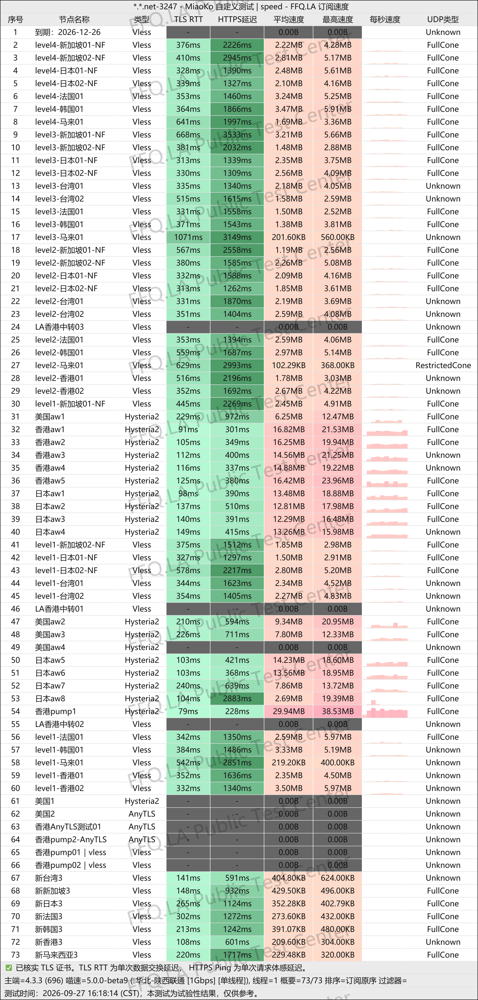
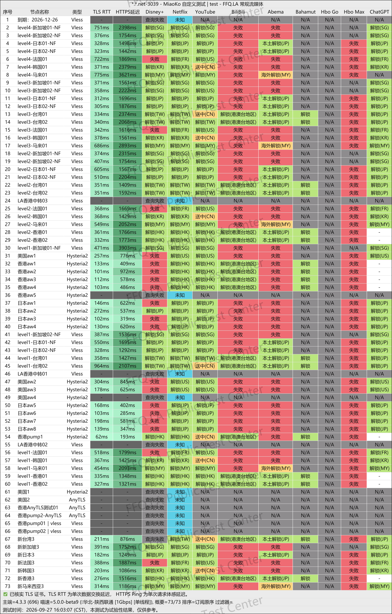
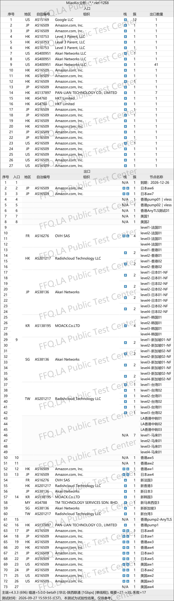

🇨🇳 [中文](README.md) | 🇺🇸 English | 🇷🇺 [Русский](README_RU.md) | 🇮🇷 [فارسی](README_FA.md)

# YangFanCloud VPN Official Website (Updated November 11, 2026)

YangFanCloud VPN Official Website<br>
Official Website: [ml.yfqz1.net](https://to.iix.im/yang01)<br>

Latest Recommended VPN Services and Node Sharing for 2026: [https://github.com/jdnei/JiChangTuiJian](https://github.com/jdnei/JiChangTuiJian)<br>

## Telegram VPN Deals & Benefits Community #AD

[VPN Giveaway Group](https://331024.de/archives/choujiang) | [VPN Chat Group](https://331024.de/archives/choujiang) | [VPN Trial Group](https://331024.de/archives/choujiang)<br>

[https://331024.de/archives/choujiang](https://331024.de/archives/choujiang)

## Invitation Code

```bash
eiJGFwD8
```

## Promo Code / Discount Code

`35% off, valid for 5 days after registering through an invitation link`

```bash
yf5165
```

## Overview

YangFanCloud VPN is a global network acceleration service offering servers in multiple regions. It supports everyday internet browsing, HD video streaming, gaming acceleration, and cross-border remote work.

Its subscription options include recurring data plans, non-expiring data packages, and dedicated private nodes. With a wide range of data allowances and flexible device limits, YangFanCloud is suitable for individuals, families, and users who regularly connect multiple devices.

## Advantages

YangFanCloud VPN offers standard nodes, dedicated IEPL connections, and exclusive routes with native residential IP addresses. Higher-tier plans support unlimited connection speeds and multiple simultaneous devices.

Its flexible subscription options include recurring plans with monthly data resets and non-expiring data packages that remain valid until the purchased data is exhausted.

The service also supports plan upgrades, additional data purchases, and customized private solutions, covering everything from light everyday use to demanding, high-traffic applications.

## Plans & Pricing

### 📅 Recurring Subscription Plans

> Similar to a monthly mobile phone plan, the date of your first purchase becomes your monthly data reset date. Your data allowance automatically resets on the same calendar day each month.

| Plan | Monthly Data | Speed | Devices | Nodes | Features | Monthly | Quarterly | Semiannual | Annual | Biennial |
|---|---:|---:|---:|---|---|---:|---:|---:|---:|---:|
| LV1 | 100 GB | 200 Mbps | 2 | Global Nodes | Standard nodes, suitable for light usage | ¥19.99 | ¥59.97 | ¥119.94 | ¥239.88 | ¥479.76 |
| LV2 | 200 GB | 300 Mbps | 3 | Global Nodes | Standard nodes, suitable for everyday usage | ¥29.99 | ¥89.97 | ¥179.94 | ¥359.88 | ¥719.76 |
| LV3 | 400 GB | 500 Mbps | 4 | Global Nodes | Selected IEPL dedicated lines, suitable for gaming and HD streaming | ¥39.99 | ¥119.97 | ¥239.94 | ¥479.88 | ¥959.76 |
| LV4 | 700 GB | 2 Gbps | 6 | Global Nodes | All-IEPL dedicated lines, suitable for professional gaming and cross-border remote work | ¥49.99 | ¥149.97 | ¥299.94 | ¥599.88 | ¥1199.76 |
| Flagship | 1.2 TB | Unlimited | 8 | Global Nodes | Extra-large data allowance, suitable for heavy users and family sharing | ¥88.99 | ¥266.97 | ¥533.94 | ¥1067.88 | ¥2135.76 |

### ⚡ Non-Expiring Data Packages

| Plan | Total Data | Speed | Devices | Validity | Price |
|---|---:|---:|---:|---|---:|
| LV1 · Non-Expiring | 100 GB | 200 Mbps | 2 | No expiration; valid until data is exhausted | ¥119 |
| LV2 · Non-Expiring | 200 GB | 300 Mbps | 3 | No expiration; valid until data is exhausted | ¥179 |
| LV3 · Non-Expiring | 400 GB | 500 Mbps | 4 | No expiration; valid until data is exhausted | ¥239 |
| LV4 · Non-Expiring | 700 GB | 2 Gbps | 6 | No expiration; valid until data is exhausted | ¥299 |
| Flagship · Non-Expiring | 1.2 TB | Unlimited | 8 | No expiration; valid until data is exhausted | ¥533 |

### 🔒 Dedicated Private Nodes

| Plan | Type | IP Address | Network | Speed | Devices | Minimum Subscription | Price | Features |
|---|---|---|---|---|---:|---|---:|---|
| Dedicated Private Node | Native Residential IP | Static native residential broadband IP | Dedicated Line | Unlimited | 2 | Minimum 6 months | ¥200 / month | Exclusive connection for AI services such as Claude and GPT; customizable location, protocol, and client; supports anti-detect browsers and routers; one-on-one setup and maintenance |

If you plan to add this content directly to a **GitHub README**, the version above is ready to copy and paste.

## 📊 Real-World Performance Tests & Analysis

#### 1. Evening Peak-Hour Speed Test Results

<br>

#### 2. Streaming Service Unblocking Report

<br>

#### 3. Exit Node and Network Entry Analysis

<br>
