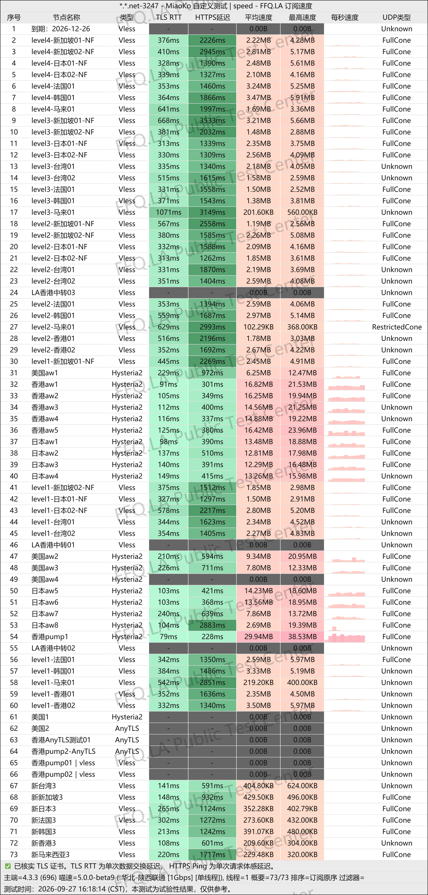
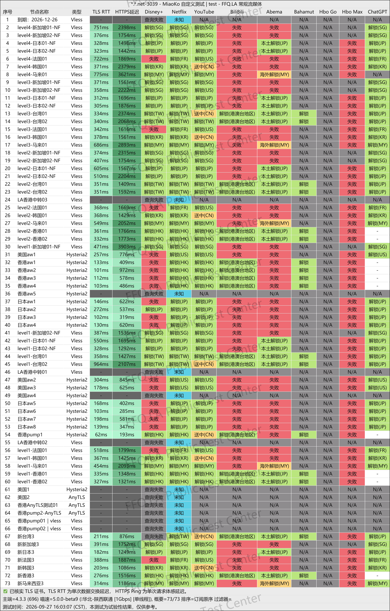
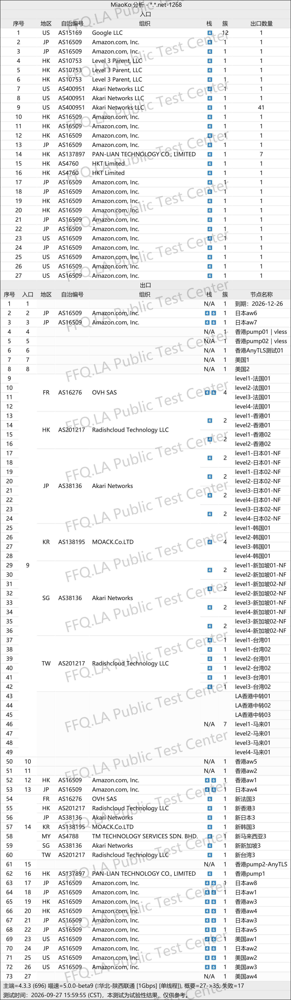

 🇨🇳 [中文](README.md) | 🇺🇸 [English](README_EN.md) | 🇷🇺 [Русский](README_RU.md) | 🇮🇷 فارسی
# آدرس رسمی VPN یانگ‌فان‌کلاد (YangFanCloud) -(به‌روزرسانی 7 نوامبر 2026)
وب‌سایت رسمی VPN یانگ‌فان‌کلاد (YangFanCloud)<br>
آدرس رسمی: [ml.yfqz1.net](https://to.iix.im/yang01)<br>

معرفی بهترین سرویس‌های VPN و اشتراک‌گذاری سرورها در سال ۲۰۲۶: [https://github.com/jdnei/JiChangTuiJian](https://github.com/jdnei/JiChangTuiJian)<br>

## انجمن تلگرامی تخفیف‌ها و مزایای VPN #AD

[گروه قرعه‌کشی VPN](https://331024.de/archives/choujiang) | [گروه گفت‌وگوی VPN](https://331024.de/archives/choujiang) | [گروه آزمایش رایگان VPN](https://331024.de/archives/choujiang)<br>

[https://331024.de/archives/choujiang](https://331024.de/archives/choujiang)

## کد دعوت

```bash
eiJGFwD8
```

## کد تخفیف

`۳۵٪ تخفیف، معتبر به مدت ۵ روز پس از ثبت‌نام از طریق لینک دعوت`

```bash
yf5165
```

## معرفی

YangFanCloud یک سرویس VPN برای افزایش سرعت و بهبود دسترسی به شبکه جهانی است که سرورهایی در مناطق مختلف ارائه می‌دهد. این سرویس برای وب‌گردی روزمره، تماشای ویدئوهای باکیفیت، بهبود اتصال بازی‌های آنلاین و دورکاری بین‌المللی مناسب است.

طرح‌های این سرویس شامل اشتراک‌های دوره‌ای با حجم مشخص، بسته‌های ترافیکی بدون تاریخ انقضا و سرورهای اختصاصی هستند. تنوع حجم ترافیک و انعطاف‌پذیری در تعداد دستگاه‌های قابل اتصال، آن را به گزینه‌ای مناسب برای کاربران شخصی، خانواده‌ها و افرادی که از چندین دستگاه استفاده می‌کنند تبدیل کرده است.

## مزایا

VPN یانگ‌فان‌کلاد سرورهای استاندارد، خطوط اختصاصی IEPL و مسیرهای اختصاصی با IP مسکونی واقعی ارائه می‌دهد. طرح‌های سطح بالاتر از سرعت نامحدود و اتصال هم‌زمان چندین دستگاه پشتیبانی می‌کنند.

این سرویس از نظر انتخاب اشتراک انعطاف‌پذیر است؛ هم طرح‌های دوره‌ای با بازنشانی خودکار حجم اینترنت در هر ماه دارد و هم بسته‌های ترافیکی بدون تاریخ انقضا که تا پایان مصرف حجم خریداری‌شده معتبر می‌مانند.

همچنین امکان ارتقای اشتراک، خرید ترافیک اضافی و سفارش راهکارهای اختصاصی وجود دارد. به همین دلیل، این سرویس می‌تواند نیاز کاربران کم‌مصرف تا کاربران حرفه‌ای و پرمصرف را پوشش دهد.

## طرح‌ها و قیمت‌ها

### 📅 اشتراک‌های دوره‌ای

> این اشتراک‌ها مشابه بسته‌های ماهانه تلفن همراه هستند. تاریخ اولین خرید، مبنای بازنشانی ماهانه ترافیک خواهد بود و حجم اینترنت در همان روز از هر ماه به‌صورت خودکار بازنشانی می‌شود.

| طرح | ترافیک ماهانه | سرعت | تعداد دستگاه | سرورها | ویژگی‌ها | ماهانه | سه‌ماهه | شش‌ماهه | سالانه | دوساله |
|---|---:|---:|---:|---|---|---:|---:|---:|---:|---:|
| LV1 | 100 GB | 200 Mbps | 2 | سرورهای جهانی | سرورهای استاندارد، مناسب استفاده سبک | ¥19.99 | ¥59.97 | ¥119.94 | ¥239.88 | ¥479.76 |
| LV2 | 200 GB | 300 Mbps | 3 | سرورهای جهانی | سرورهای استاندارد، مناسب استفاده روزمره | ¥29.99 | ¥89.97 | ¥179.94 | ¥359.88 | ¥719.76 |
| LV3 | 400 GB | 500 Mbps | 4 | سرورهای جهانی | برخی خطوط اختصاصی IEPL، مناسب بازی و پخش ویدئوی HD | ¥39.99 | ¥119.97 | ¥239.94 | ¥479.88 | ¥959.76 |
| LV4 | 700 GB | 2 Gbps | 6 | سرورهای جهانی | تمام مسیرها از خطوط اختصاصی IEPL، مناسب بازی حرفه‌ای و دورکاری بین‌المللی | ¥49.99 | ¥149.97 | ¥299.94 | ¥599.88 | ¥1199.76 |
| پرچم‌دار | 1.2 TB | نامحدود | 8 | سرورهای جهانی | حجم بسیار بالا، مناسب کاربران پرمصرف و استفاده خانوادگی | ¥88.99 | ¥266.97 | ¥533.94 | ¥1067.88 | ¥2135.76 |

### ⚡ بسته‌های ترافیکی بدون تاریخ انقضا

| طرح | حجم کل ترافیک | سرعت | تعداد دستگاه | اعتبار | قیمت |
|---|---:|---:|---:|---|---:|
| LV1 · بدون انقضا | 100 GB | 200 Mbps | 2 | بدون تاریخ انقضا، تا پایان مصرف حجم | ¥119 |
| LV2 · بدون انقضا | 200 GB | 300 Mbps | 3 | بدون تاریخ انقضا، تا پایان مصرف حجم | ¥179 |
| LV3 · بدون انقضا | 400 GB | 500 Mbps | 4 | بدون تاریخ انقضا، تا پایان مصرف حجم | ¥239 |
| LV4 · بدون انقضا | 700 GB | 2 Gbps | 6 | بدون تاریخ انقضا، تا پایان مصرف حجم | ¥299 |
| پرچم‌دار · بدون انقضا | 1.2 TB | نامحدود | 8 | بدون تاریخ انقضا، تا پایان مصرف حجم | ¥533 |

### 🔒 سرورهای اختصاصی خصوصی

| طرح | نوع | آدرس IP | نوع اتصال | سرعت | تعداد دستگاه | حداقل مدت اشتراک | قیمت | ویژگی‌ها |
|---|---|---|---|---|---:|---|---:|---|
| سرور اختصاصی | IP مسکونی واقعی | IP ثابت و واقعی اینترنت خانگی | خط اختصاصی | نامحدود | 2 | حداقل ۶ ماه | ¥200 / ماه | اتصال اختصاصی برای استفاده از سرویس‌های هوش مصنوعی مانند Claude و GPT؛ امکان سفارشی‌سازی منطقه، پروتکل و کلاینت؛ پشتیبانی از مرورگرهای ضدشناسایی اثر انگشت و روترها؛ راه‌اندازی و نگهداری اختصاصی با پشتیبانی فردی |

اگر قصد دارید این محتوا را مستقیماً در فایل **GitHub README** قرار دهید، نسخه بالا آماده کپی و جای‌گذاری است.

## 📊 آزمایش‌های عملی عملکرد و تحلیل نتایج

#### ۱. نتایج آزمایش سرعت در ساعات اوج مصرف شبانه

<br>

#### ۲. گزارش رفع محدودیت سرویس‌های پخش آنلاین

<br>

#### ۳. تحلیل سرورهای خروجی و مسیرهای ورودی شبکه

<br>
