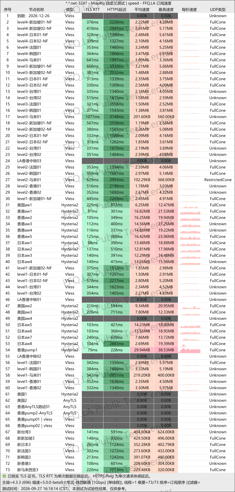
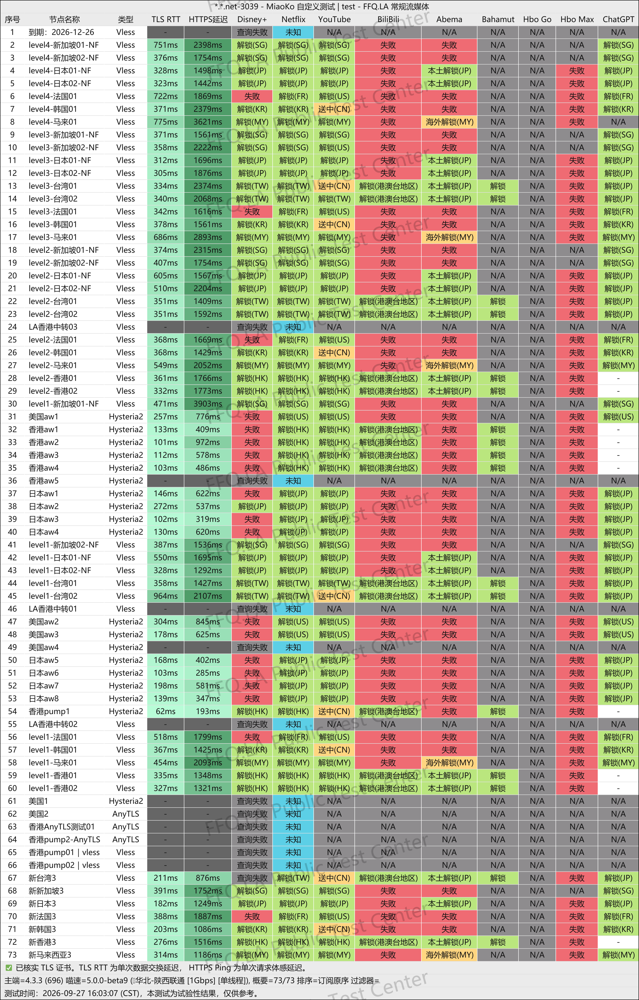
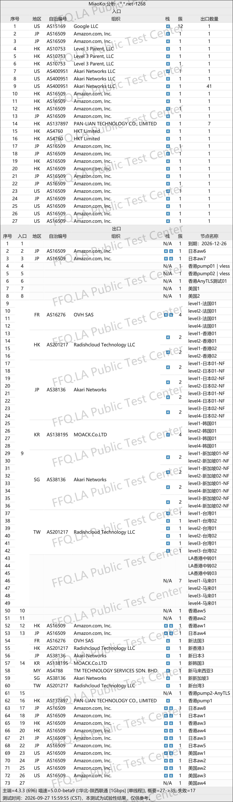

🇨🇳 [中文](README.md) | 🇺🇸 [English](README_EN.md) | 🇷🇺 Русский | 🇮🇷 [فارسی](README_FA.md)

# Официальный сайт YangFanCloud VPN (обновлено 5 ноября 2026)

Официальный сайт VPN-сервиса YangFanCloud<br>
Официальный адрес: [ml.yfqz1.net](https://to.iix.im/yang01)<br>

Лучшие VPN-сервисы 2026 года: рекомендации и подборка серверов: [https://github.com/jdnei/JiChangTuiJian](https://github.com/jdnei/JiChangTuiJian)<br>

## Telegram-сообщество VPN: акции, скидки и бонусы #AD

[Группа розыгрышей VPN](https://331024.de/archives/choujiang) | [Чат VPN](https://331024.de/archives/choujiang) | [Группа тестирования VPN](https://331024.de/archives/choujiang)<br>

[https://331024.de/archives/choujiang](https://331024.de/archives/choujiang)

## Пригласительный код

```bash
eiJGFwD8
```

## Промокод / Код скидки

`Скидка 35%, действует в течение 5 дней после регистрации по приглашению`

```bash
yf5165
```

## Описание

YangFanCloud VPN — сервис для ускорения и оптимизации международного интернет-соединения, предлагающий серверы в различных регионах мира. Он подходит для повседневного просмотра веб-страниц, потокового видео высокой чёткости, онлайн-игр и удалённой работы с зарубежными ресурсами.

Сервис предлагает тарифы с периодическим обновлением трафика, пакеты без срока действия и выделенные частные серверы. Широкий выбор объёмов трафика и гибкие ограничения на количество устройств делают YangFanCloud подходящим решением для отдельных пользователей, семей и владельцев нескольких устройств.

## Преимущества

YangFanCloud VPN предлагает стандартные серверы, выделенные линии IEPL и эксклюзивные маршруты с настоящими резидентскими IP-адресами. Старшие тарифы поддерживают неограниченную скорость подключения и одновременную работу нескольких устройств.

Сервис отличается гибкой тарифной системой. Доступны как периодические подписки с автоматическим ежемесячным обновлением трафика, так и бессрочные пакеты, действующие до полного расходования приобретённого объёма данных.

Также предусмотрены повышение тарифного плана, покупка дополнительного трафика и индивидуальная настройка частных решений. Это позволяет удовлетворить потребности как обычных пользователей, так и тех, кому необходимы большие объёмы трафика и высокая производительность.

## Тарифы и цены

### 📅 Периодические подписки

> Эти тарифы работают аналогично ежемесячным пакетам мобильной связи. Дата первой покупки становится датой обновления трафика. Каждый месяц в соответствующий календарный день доступный объём данных автоматически восстанавливается.

| Тариф | Трафик в месяц | Скорость | Устройства | Серверы | Особенности | За месяц | За квартал | За полгода | За год | За 2 года |
|---|---:|---:|---:|---|---|---:|---:|---:|---:|---:|
| LV1 | 100 GB | 200 Mbps | 2 | Серверы по всему миру | Стандартные серверы, подходят для небольших нагрузок | ¥19.99 | ¥59.97 | ¥119.94 | ¥239.88 | ¥479.76 |
| LV2 | 200 GB | 300 Mbps | 3 | Серверы по всему миру | Стандартные серверы, подходят для повседневного использования | ¥29.99 | ¥89.97 | ¥179.94 | ¥359.88 | ¥719.76 |
| LV3 | 400 GB | 500 Mbps | 4 | Серверы по всему миру | Часть маршрутов использует выделенные линии IEPL; подходит для игр и HD-видео | ¥39.99 | ¥119.97 | ¥239.94 | ¥479.88 | ¥959.76 |
| LV4 | 700 GB | 2 Gbps | 6 | Серверы по всему миру | Все маршруты используют выделенные линии IEPL; подходит для профессионального гейминга и международной удалённой работы | ¥49.99 | ¥149.97 | ¥299.94 | ¥599.88 | ¥1199.76 |
| Флагманский | 1.2 TB | Без ограничений | 8 | Серверы по всему миру | Очень большой объём трафика, подходит для активных пользователей и семейного использования | ¥88.99 | ¥266.97 | ¥533.94 | ¥1067.88 | ¥2135.76 |

### ⚡ Пакеты трафика без срока действия

| Тариф | Общий объём трафика | Скорость | Устройства | Срок действия | Цена |
|---|---:|---:|---:|---|---:|
| LV1 · Бессрочный | 100 GB | 200 Mbps | 2 | Без срока действия, до полного расходования трафика | ¥119 |
| LV2 · Бессрочный | 200 GB | 300 Mbps | 3 | Без срока действия, до полного расходования трафика | ¥179 |
| LV3 · Бессрочный | 400 GB | 500 Mbps | 4 | Без срока действия, до полного расходования трафика | ¥239 |
| LV4 · Бессрочный | 700 GB | 2 Gbps | 6 | Без срока действия, до полного расходования трафика | ¥299 |
| Флагманский · Бессрочный | 1.2 TB | Без ограничений | 8 | Без срока действия, до полного расходования трафика | ¥533 |

### 🔒 Выделенные частные серверы

| Тариф | Тип | IP-адрес | Подключение | Скорость | Устройства | Минимальный срок | Цена | Особенности |
|---|---|---|---|---|---:|---|---:|---|
| Выделенный частный сервер | Настоящий резидентский IP | Статический IP-адрес домашнего интернет-подключения | Выделенная линия | Без ограничений | 2 | От 6 месяцев | ¥200 / месяц | Эксклюзивное подключение для использования ИИ-сервисов, включая Claude и GPT; настройка страны, протокола и клиента; поддержка антидетект-браузеров и маршрутизаторов; индивидуальная установка и техническое обслуживание |

Если вы собираетесь разместить этот материал непосредственно в **GitHub README**, приведённую выше версию можно скопировать и вставить без дополнительного форматирования.

## 📊 Практические тесты производительности и анализ

#### 1. Результаты тестирования скорости в вечерние часы пик

<br>

#### 2. Отчёт о разблокировке стриминговых сервисов

<br>

#### 3. Анализ выходных серверов и входящих сетевых маршрутов

<br>
